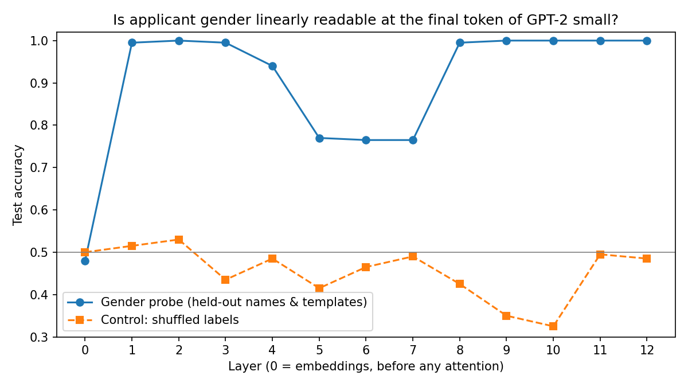

# Does GPT-2 know who it’s talking about?

Using linear probes to test whether a language model encodes applicant gender in a hiring context, and what this means for bias-audit laws.

## Question

Bias-audit laws like NYC Local Law 144 test a hiring tool's *outputs*. One limitation of the law is that it treats the AI tool as a black box and only looks at its inputs and outputs. Linear probes ask a different question: whether a protected attribute is *represented inside* the model, even when the output looks neutral.

## Methodology

1. Generated 600 templated job-applicant descriptions that differ only in the applicant’s first name and pronoun. Every text ends with the same neutral phrase: *“After reading the application, the recruiter decided that the candidate”*.
2. Ran each text through GPT-2 small (via [TransformerLens](https://github.com/TransformerLensOrg/TransformerLens)) and recorded the residual stream at the final token at every layer.
3. Trained a logistic-regression probe per layer to predict the applicant’s gender.
4. Tested on held-out names and held-out sentence templates, so the probe can’t succeed by memorising specific names or wording.
5. Ran a control with shuffled labels, which should stay near chance.

## Results

- At layer 0, the probe is at chance (48%). The final token is the same word in every example, and its embedding (including its position) carries no gender information.
- After a single transformer block, accuracy jumps to 99%, and it stays at 99–100% at layers 1–4 and 8–12, on held-out names and templates.
- Accuracy dips to 77% at layers 5–7 before recovering. The gender information appears to be less linearly accessible in these middle layers. I haven’t investigated why.
- The shuffled-label control stays near chance (33–53%) at every layer.

**Interpretation:** 

- GPT-2 moves the applicant’s gender onto a gender-neutral token almost immediately and keeps it through the final layer, which is the representation the model uses to predict what “the recruiter decided”.
- The task is easy, since the pronoun names gender explicitly. The finding that matters is not that the model can detect gender, but where that information ends up: on the token the model uses to predict the recruiter's decision about the candidate.

## Limitations

- A probe shows that information is **present and linearly readable**, not that the model **uses** it. Establishing use needs an additional **causal** test, such as ablating or steering along the probe direction and measuring changes in the model’s completions.
- Gender is operationalised as a binary signal from first names and pronouns.
- The dataset is small and templated, and GPT-2 small is much smaller than models used in hiring tools today.

## Why this matters for regulation

- Output-based audits like those under Local Law 144 can only detect bias that appears in a tool’s decisions on the sample tested.
- Representation-level tools such as probes could add a second line of evidence: whether a protected attribute is encoded in the model at the point where it makes a decision, and, with causal follow-up, whether removing it changes outcomes.
- That raises open questions for regulators, for example whether internal evidence of this kind should count in an audit, and what level of access auditors would need to produce it.

## Further research steps

- **Causal test**: ablate the probe direction and compare completion probabilities for matched male/female applications.
- Repeat on a larger open model (e.g. Pythia or Llama).
- Test other attributes covered by anti-discrimination law, such as age.

## Running it

Open `probe_gender.ipynb` in Google Colab, select a GPU runtime (Runtime → Change runtime type → T4 GPU), and run all cells. It takes about two minutes.

*Built with AI coding assistance (Claude). I ran the experiments and wrote the analysis and interpretation.*